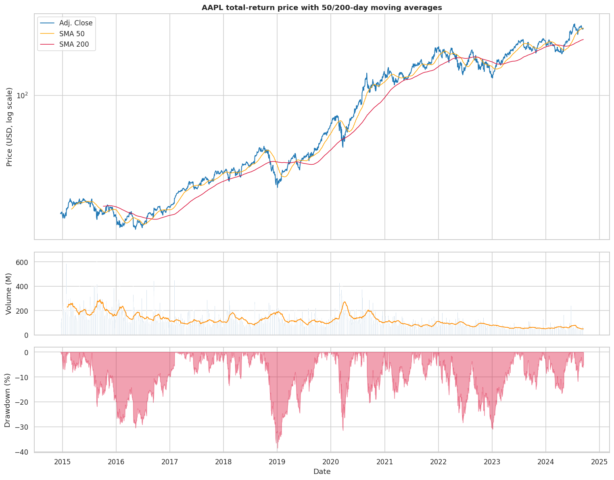
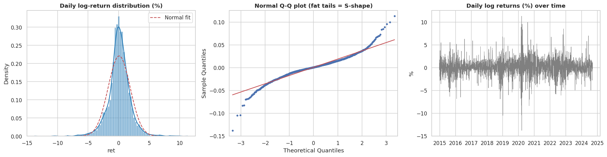
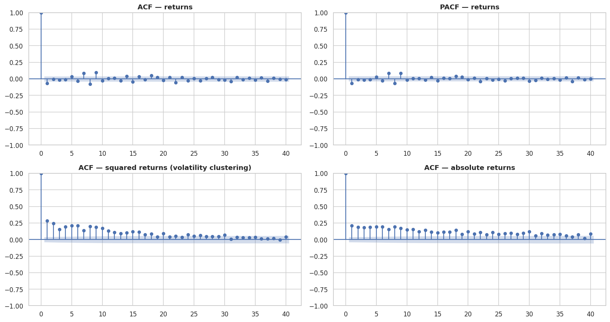
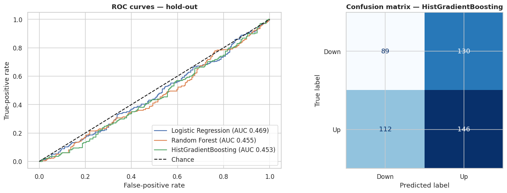
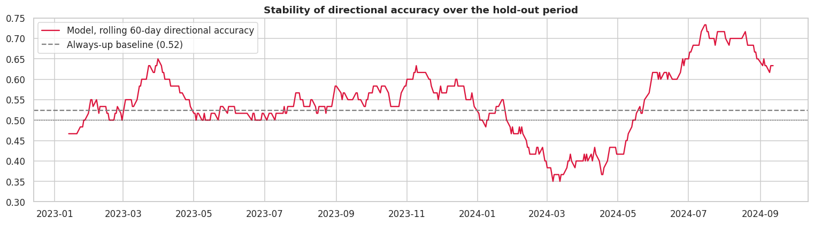

# AAPL Next-Day Return Forecasting: A Data Analytics × Machine Learning Project

---

## Project Overview

This project presents an end-to-end, leakage-safe data analytics and machine learning workflow for modeling and forecasting Apple Inc. (`AAPL`) daily returns. Rather than modeling non-stationary price levels directly, where a forecast can appear accurate simply by copying the prior day's close, the primary regression target is the **next-day percentage log return** ($100 \times \log(P_{t+1}/P_t)$), alongside next-day **direction** (`target_dir = 1[target_ret > 0]`) for classification. Reconstructed price forecasts ($\hat{P}_{t+1} = P_t \cdot \exp(\hat{r}/100)$) are evaluated against a naive persistence benchmark (*tomorrow = today*).

### Research Questions

1. **RQ1: Data & Analytics:** What are the statistical properties of `AAPL` returns (stationarity, fat tails, volatility clustering, and calendar seasonality)?
2. **RQ2: Machine Learning:** Can regularized linear models and tree ensembles forecast next-day returns (regression) and direction (classification) better than naive baselines out-of-sample?
3. **RQ3: Economics:** If a predictive signal exists, does it survive transaction costs in a backtested strategy?

---

## Key Methodology & Design Principles

* **Total-Return OHLC Reconstruction:** Raw `Open`, `High`, and `Low` prices are scaled by the `Adj Close / Close` adjustment factor and `Close` is set to `Adj Close` so returns reflect dividend adjustments consistently across OHLC columns.
* **Data Quality & Event Retention:** The raw dataset (`2014-12-19` to `2024-09-13` in cleaned series) has `0` missing values, `0` duplicate dates, `0` zero-volume days, `0` non-positive prices, `0` inconsistent OHLC rows, and `0` calendar gaps greater than 4 days. Eleven extreme-return days (`|z| > 4`, such as March 2020) are retained as genuine market events.
* **Strict Causality & Truncation Testing:** All 40 engineered features, spanning return memory, momentum, rolling/range volatility, price action, trend/moving-average distances, oscillators, volume metrics, and cyclical/month-end calendar features, use information available at or before day $t$'s close to predict day $t+1$'s return. A programmatic truncation test (`lookahead_test`) verifies identical feature values at cut points `(400, 900, 1500, 2100)` regardless of future data.
* **Time-Aware Validation:** Uses an untouched final `20%` chronological hold-out test set (`477` rows: `2022-10-19` to `2024-09-12`), a `GAP=1` purge between `train` (`1,907` rows: `2015-03-24` to `2022-10-17`) and `test` to prevent target overlap, and 5-fold `TimeSeriesSplit` walk-forward cross-validation inside the training set.
* **Honest Statistical Evaluation:** Evaluates regression models via `RMSE`, `MAE`, out-of-sample $R^2$ (`R2_OS` relative to the zero-return benchmark), directional accuracy (`DirAcc`), and Diebold-Mariano tests, and evaluates classifiers via `Accuracy`, `Balanced Accuracy`, `ROC-AUC`, `F1`, and binomial tests against majority-class baselines.

---

## Highlights from Exploratory & Out-of-Sample Analysis

* **Price, Volume & Drawdown:** Over the 2014-2024 sample, `AAPL` shows strong long-term total-return growth alongside distinct volume bursts and multi-month drawdowns.


* **Return Distribution & Stationarity:** Daily log returns have a mean of `0.0894%` (`22.5364%` annualized), daily volatility of `1.8065%` (`28.6770%` annualized), skewness of `-0.1957`, excess kurtosis of `5.4029` (Jarque-Bera $p = 0.0000$), and a maximum drawdown of `-38.5%`. ADF and KPSS tests support stationarity for log returns (`ADF p = 0.0000`, `KPSS p = 0.1000`), whereas price levels are non-stationary.


* **Volatility vs. Return Predictability:** Lag-1 return autocorrelation is tiny (`-0.0105` Spearman), whereas volatility persistence (`|ret_t|` vs. `|ret_{t+1}|` Spearman `0.1268`, Ljung-Box on squared returns highly significant) and volume-change / absolute-return co-movement (`0.3262` Spearman) are much stronger.


* **Direction Classification on the Hold-Out Set:** Out-of-sample ROC curves and confusion-matrix diagnostics illustrate how direction classifiers perform relative to chance and majority-class baselines on noisy daily return signs.


* **Hold-Out Robustness by Year & Volatility Regime:** Across the 477-day hold-out period (`51 + 250 + 176` days across 2022-2024, or `181 + 204 + 92` days across Low, Mid, and High volatility regimes), squared-error performance (`Model / RW RMSE`) stays right around parity (`0.994` to `1.004`), while directional accuracy varies noticeably across sub-periods and regimes:

### Hold-Out Breakdown by Year

| Year | Days | RMSE Model | RMSE Random Walk | Model / RW RMSE | DirAcc |
| --- | --- | --- | --- | --- | --- |
| **2022** | 51 | 2.616 | 2.606 | 1.004 | 0.412 |
| **2023** | 250 | 1.275 | 1.283 | 0.994 | 0.560 |
| **2024** | 176 | 1.480 | 1.484 | 0.998 | 0.551 |

### Hold-Out Breakdown by Volatility Regime

*(A `Model / RW RMSE` ratio `< 1.000` indicates lower RMSE than the random walk benchmark.)*

| Regime | Days | RMSE Model | RMSE Random Walk | Model / RW RMSE | DirAcc |
| --- | --- | --- | --- | --- | --- |
| **Low vol** | 181 | 1.342 | 1.342 | 1.000 | 0.470 |
| **Mid vol** | 204 | 1.382 | 1.388 | 0.996 | 0.598 |
| **High vol** | 92 | 2.151 | 2.154 | 0.999 | 0.554 |

* **Rolling Directional Accuracy Stability:** A rolling 60-day directional accuracy view across the hold-out window shows that directional hit rates fluctuate substantially over time, moving above the `0.52` always-up reference during stretches of 2023 and mid-2024, dipping below `0.40` around early-to-spring 2024, and reinforcing why single-period or rolling hit rates require careful regime and baseline context.


---

## Repository Structure

```text
.
├── AAPL_Forecasting_Project.ipynb     # End-to-end executed notebook (Sections 1-14)
├── requirements.txt                   # Python package dependencies
├── .gitignore                         # Git ignore rules
├── data/
│   └── AAPL_raw.csv                   # Cached AAPL daily OHLCV dataset from Yahoo Finance
├── images/
│   ├── acf_volatility_clustering.png  # ACF/PACF of returns vs. squared/absolute returns
│   ├── price_volume_drawdown.png      # AAPL total-return price, volume, and drawdown chart
│   ├── return_distribution.png        # Return histogram, Q-Q plot, and time series
│   ├── roc-curves.png                 # Hold-out ROC curves and confusion matrix
│   └── rolling_diracc_stability.png   # Rolling 60-day directional accuracy over hold-out
└── artifacts/
    ├── best_regression_model.joblib   # Serialized best regression pipeline/estimator
    ├── best_direction_model.joblib    # Serialized best direction classification pipeline/estimator
    └── model_metadata.json            # Run configuration, feature list, and evaluation metadata

```

---

## How to Run

1. **Install dependencies:**

```bash
pip install -r requirements.txt

```

2. **Launch and execute the notebook:**
Open `AAPL_Forecasting_Project.ipynb` in Jupyter Notebook, JupyterLab, VS Code, or Google Colab and run all cells sequentially. If Yahoo Finance is unreachable, the ingestion step automatically falls back to `data/AAPL_raw.csv`.

---

## Limitations & Next Steps

> *Disclaimer: This project is for educational and analytical research purposes and does not constitute financial or investment advice.*

### Limitations

* **Single asset, single regime.** AAPL in 2015-2024 was a historically strong bull market; "always up" is a tough benchmark and results may not transfer to other stocks or periods.
* **Only price/volume information.** No fundamentals, macro, options, news or sentiment data.
* **Simplified trading model.** Long/cash only, no slippage, taxes, borrow costs or position sizing; costs are a flat basis-point assumption.
* **Statistical power.** A hold-out of ~480 days cannot reliably detect the tiny edges (a few tenths of a percent of R²) that exist in daily returns, hence the significance tests.
* **Multiple testing.** Several models, features and metrics were compared; any single "significant" result should be treated with caution.

### Recommended Next Steps

1. **Forecast volatility instead of direction.** EDA showed strong volatility clustering; GARCH / HAR-RV / gradient boosting on realised-volatility features usually yields genuinely predictive models and directly supports risk management and position sizing.
2. **Add exogenous data:** VIX, S&P 500 / Nasdaq returns, interest rates, sector ETFs, earnings-date flags, news sentiment.
3. **Move to multi-asset / panel models** (many tickers share one model) to increase sample size.
4. **Try sequence models** (LSTM / Temporal Fusion Transformer) and **quantile regression** to forecast return distributions rather than point estimates.
5. **Evaluate with rolling-origin re-training** (re-fit every month) and add a probability-threshold / confidence-based trading rule.
6. **Wrap `predict_next_day()` in a small Streamlit/FastAPI app** and monitor live forecast error for drift.

---

**Author:** Malaika Junaid

**Asset & Sample Period:** Apple Inc. (`AAPL`) daily market data (`2014-12-19` to `2024-09-16`, 2,449 raw rows)